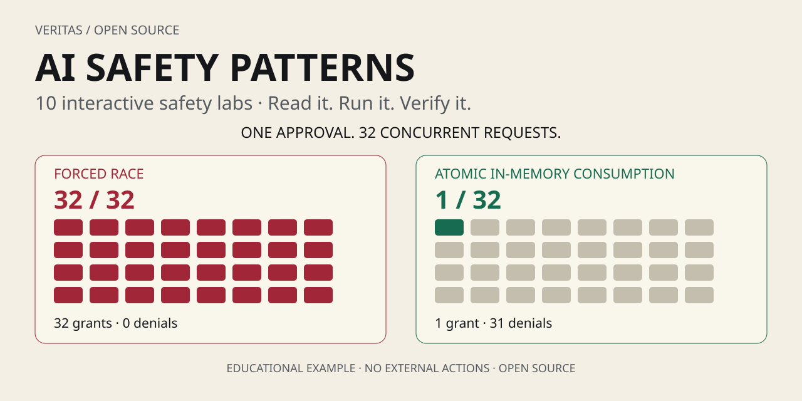

# AI Safety Patterns



**1回の承認。1回の権限消費。**

**[▶ ブラウザで体験する（インストール不要）](https://veritasfuji-japan.github.io/ai-safety-patterns/)**

[English](README.md) · [デモのソース](demo/index.html) · [VERITAS OS](https://github.com/veritasfuji-japan/veritas_os)

AIエージェントの安全設計を、失敗例と改善例の比較で学ぶ教材です。APIキー・外部ライブラリ・外部操作は不要です。

## 5つの体験型教材

| パターン | 学ぶ問題 | Python実装 |
| --- | --- | --- |
| 01 — [実行権限の単回消費](https://veritasfuji-japan.github.io/ai-safety-patterns/single-use.html) | 重複許可 | [authority.py](authority.py) |
| 02 — 実行対象の紐付け | 実行者・操作・対象・金額の置換 | [safety_patterns.py](safety_patterns.py) |
| 03 — 取消しと送信許可の競合 | 古い確認と予約確定の順序 | [safety_patterns.py](safety_patterns.py) |
| 04 — 人間による承認 | 推奨と許可の混同 | [safety_patterns.py](safety_patterns.py) |
| 05 — 実行結果の証拠 | 自己報告と確認済み結果の混同 | [safety_patterns.py](safety_patterns.py) |

ブラウザは決定論的シミュレーションです。Pythonでは01と03に実スレッドによるテストを含めます。各教材に保証範囲の限界を記載しています。

## パターン01：実行権限の単回消費

1回だけ許可された操作に対し、32のワーカーが同時に権限を消費しようとするとどうなるでしょうか。

| 意図的に競合を発生させた設計 | 原子的なメモリ内消費 |
| --- | --- |
| 32許可・0拒否 | 1許可・31拒否 |

## 試す

リポジトリを取得し、ルートでPython 3.10以上を使用して実行します。

```sh
python -m unittest -v
# 任意：Node.js 22以上でブラウザモデルのテスト
node --test test_browser_models.cjs
```

`demo/index.html` をブラウザで開くと日英対応の教材を操作できます。デモは決定論的なシミュレーションです。Pythonテストでは実スレッドを使い、危険な順序を意図的に発生させます。

## 改善の原理

確認と更新が別々だと複数の要求が未消費状態を観測できます。ロックで確認と更新を一体化することで、単一プロセス内の同じオブジェクトに対する消費を1回に制限します。

## 保証しないこと

教育用コードであり、本番用セキュリティ製品ではありません。承認の真正性、本番水準の紐付け、再起動後の永続化、プロセス間の調整、永続的な取消し、外部処理の一回限りの成立は保証しません。許可は送信や成功の証明ではありません。外部操作は実行しません。

## VERITASとの関係

[VERITAS OS](https://github.com/veritasfuji-japan/veritas_os) の思想に基づく独立教材です。本体の認証や検証結果を示すものではありません。パターン01〜05を収録しています。

## ライセンス

[MIT](LICENSE)。
