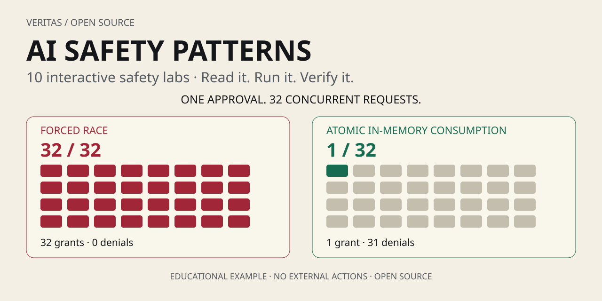
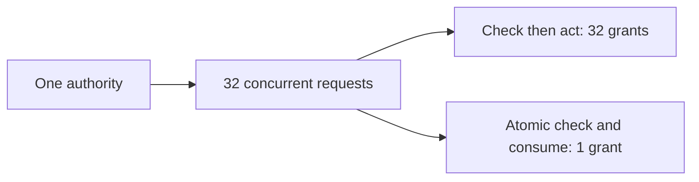

# AI Safety Patterns

<a href="https://github.com/veritasfuji-japan/veritas_os"></a> · An independent open-source learning project inspired by VERITAS OS.



**Read it. Run it. Verify it.**

One approval. One authority consumption.

**[▶ Try the live demo — no installation required](https://veritasfuji-japan.github.io/ai-safety-patterns/)**

[日本語](README.ja.md) · [Browser demo source](demo/index.html) · [VERITAS OS](https://github.com/veritasfuji-japan/veritas_os)

Learn how AI agent safety can fail — and how to test a concrete design improvement. No API keys, dependencies or external actions.

## Five interactive safety labs

| Pattern | Failure explored | Python example |
| --- | --- | --- |
| 01 — [Single-Use Authority](https://veritasfuji-japan.github.io/ai-safety-patterns/single-use.html) | Duplicate grants | [authority.py](authority.py) |
| 02 — [Bound Authority](https://veritasfuji-japan.github.io/ai-safety-patterns/#bound-authority) | Actor, action, target or amount substitution | [safety_patterns.py](safety_patterns.py) |
| 03 — [Revocation Race](https://veritasfuji-japan.github.io/ai-safety-patterns/#revocation-race) | Stale checks vs reservation ordering | [safety_patterns.py](safety_patterns.py) |
| 04 — [Human Approval](https://veritasfuji-japan.github.io/ai-safety-patterns/#human-approval) | Recommendation mistaken for permission | [safety_patterns.py](safety_patterns.py) |
| 05 — [Outcome Evidence](https://veritasfuji-japan.github.io/ai-safety-patterns/#outcome-evidence) | Self-report mistaken for confirmed effect | [safety_patterns.py](safety_patterns.py) |

Each lab compares an unsafe toy policy with a scoped improvement. Browser simulations are deterministic; Python examples test actual threads for patterns 01 and 03. See limitations in each lab.

## Pattern 01: Single-use authority

Imagine approving one operation. What happens when 32 workers try to consume that same approval concurrently?

| Deliberately scheduled race | Atomic in-memory consumption |
| --- | --- |
| 32 grants, 0 denials | 1 grant, 31 denials |



## Try it

Download or clone this repository, then run from its root with Python 3.10+:

```sh
python -m unittest -v
# Optional: Node.js 22+ for browser model tests
node --test test_browser_models.cjs
```

Open `demo/index.html` locally in a browser for an interactive English/Japanese simulation. The demo is deterministic; the Python tests use real threads and deliberately force the unsafe interleaving.

## Why it works

A check followed by a separate update permits multiple workers to see the same unused flag. A lock makes the check and update indivisible for callers sharing one object in one process.

## What this does NOT prove

This is an educational example, not production security software. It does not authenticate approvals, implement production-grade binding, persist consumption across restarts, coordinate processes, implement durable revocation or guarantee exactly-once external effects. A grant is not proof of dispatch or success. No external action is performed.

## About VERITAS

Inspired by [VERITAS OS](https://github.com/veritasfuji-japan/veritas_os), which addresses execution authority and evidence. This standalone example is not a certification or test of the production system.

## Contribute

See [CONTRIBUTING.md](CONTRIBUTING.md). Patterns 01–05 are included. Contributions should add reproducible positive and negative cases and explicit limitations.

## License

[MIT](LICENSE).
