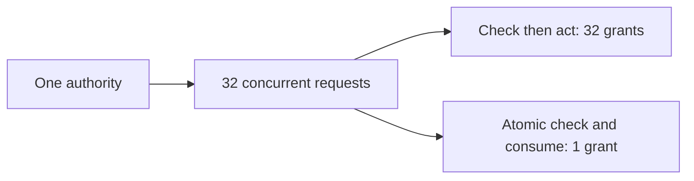

# AI Safety Patterns


**Read it. Run it. Verify it.**

One approval. One authority consumption.

[日本語](README.ja.md) · [Browser demo source](demo/index.html) · [VERITAS OS](https://github.com/veritasfuji-japan/veritas_os)

Learn how AI agent safety can fail — and how to test a concrete design improvement. No API keys, dependencies or external actions.

## Pattern 01: Single-use authority

Imagine approving one operation. What happens when 32 workers try to consume that same approval concurrently?

| Deliberately scheduled race | Atomic in-memory consumption |
| --- | --- |
| 32 grants, 0 denials | 1 grant, 31 denials |



## Try it

Download or clone this repository, then run from its root with Python 3.10+:

```sh
python -m unittest -v
```

Open `demo/index.html` locally in a browser for an interactive English/Japanese simulation. The demo is deterministic; the Python tests use real threads and deliberately force the unsafe interleaving.

## Why it works

A check followed by a separate update permits multiple workers to see the same unused flag. A lock makes the check and update indivisible for callers sharing one object in one process.

## What this does NOT prove

This is an educational example, not production security software. It does not authenticate approvals, bind targets, persist consumption across restarts, coordinate processes, handle revocation or guarantee exactly-once external effects. A grant is not proof of dispatch or success. No external action is performed.

## About VERITAS

Inspired by [VERITAS OS](https://github.com/veritasfuji-japan/veritas_os), which addresses execution authority and evidence. This standalone example is not a certification or test of the production system.

## Contribute

See [CONTRIBUTING.md](CONTRIBUTING.md). Only pattern 01 is implemented; additional patterns are proposals, not shipped features.

## License

[MIT](LICENSE).
